# LibreHU FM

Radio FM **et radio internet** (voir [Radio internet](#radio-internet)) pour autoradios Autochips AC8257 (Jancar UJC201)
et autres appareils MediaTek, au style des interfaces voiture (thème sombre, grosses cibles tactiles), avec **widget**
pour le lanceur
[LibreHU-Launcher](https://github.com/LibreHU/LibreHU-Launcher-App).

- Puce FM interne MediaTek (combo **MT6631**) pilotée par `/dev/fm`, via le JNI FM d'AOSP (Apache 2.0, voir
  [app/src/main/cpp/fmr/README.md](app/src/main/cpp/fmr/README.md)). Les codes ioctl sont les mêmes que ceux de
  l'app radio Jancar d'origine.
- Son : comme l'app radio Jancar, **patch audio matériel** tuner FM → haut-parleur (le son ne passe pas par l'app,
  une piste muette garde le flux média actif) ; à défaut, source de capture `RADIO_TUNER` recopiée vers un flux
  média (méthode « render » d'AOSP FMRadio). Le pilote MediaTek coupe le son de la puce pendant un accord, une
  recherche ou un balayage : comme `FmService.tuneStation` d'AOSP, l'appli le rétablit après chacun (sinon silence
  jusqu'à pause / lecture).
- AC8257 : structure d'accord et unités du pilote `/dev/fm` de l'AC8257 (détecté par `ro.mediatek.platform`),
  relevées dans la `libfmjni.so` de Jancar.
- **Logo de la station** : recherché par le nom RDS dans [Radio Browser](https://www.radio-browser.info)
  (base ouverte), seulement si le nom correspond, puis gardé en cache par fréquence ; affiché dans l'app, le widget,
  la notification et la carte média du lanceur. Nécessite Internet la première fois. Les noms RDS (8 caractères,
  souvent abrégés) sont rapprochés : « ICIVAUCL » trouve « ici Vaucluse » (ou son ancien nom « France Bleu
  Vaucluse »), « RTV FM » trouve « RTV » ou « Radio RTV ». Une station absente de Radio Browser : **toucher le
  logo** pour choisir une image pour cette fréquence (ou revenir au logo automatique).
- Recherche ▲▼, pas de 0,1 MHz (0,2 MHz aux Amériques), balayage de la bande, favoris.
- **Bande et région** (Paramètres) : limites de la bande, pas d'accord, désaccentuation et noms des types de programme
  de la région, choisis d'après le pays (celui des logos, sinon celui de l'autoradio) ou à la main :
  - Europe, Afrique, Asie : 87,5–108 MHz, pas de 100 kHz, désaccentuation 50 µs, types de programme RDS ;
  - Amériques et Corée du Sud : 87,5–107,9 MHz sur les dixièmes impairs (87,9, 88,1…), pas de 200 kHz,
    désaccentuation **75 µs**, types de programme **RBDS** (Rock, Top 40, Talk…) ;
  - Brésil : **bande étendue** 76,1–107,9 MHz sur les dixièmes impairs (canaux 5 et 6 rendus à la radio, émetteurs
    depuis mai 2021), pas de 200 kHz, 75 µs, types de programme RDS ; à choisir à la main au Chili (76–108 MHz annoncé
    en 2023) ;
  - Japon : 76–95 MHz, pas de 100 kHz, 50 µs.

  Sources : articles Wikipédia [FM broadcast band](https://en.wikipedia.org/wiki/FM_broadcast_band) et
  [FM broadcasting](https://en.wikipedia.org/wiki/FM_broadcasting), [Radio Data System](https://en.wikipedia.org/wiki/Radio_Data_System)
  (types de programme RDS et RBDS). La désaccentuation est envoyée au pilote de l'AC8257 à la mise en marche
  (`fm_tune_parm.deemphasis`) : avant, l'appli imposait 50 µs partout, d'où des aigus trop forts et plus de souffle
  sur les stations américaines, émises avec une préaccentuation de 75 µs. Un changement de région redémarre la radio.
  **Essai (02/11/2026)** : région Amériques et RDS américain (RBDS) parfaits chez Reo Au In, aux États-Unis.
- **RDS** décodé par la puce FM : nom de station, radiotexte, type de programme (PTY), TP / TA, fréquences
  alternatives (AF, option), nommage automatique des favoris. Le pilote FM de l'AC8257 rend un enregistrement RDS de
  720 octets (balises RT+ en plus) : l'appli, qui en demandait 688, n'en recevait aucun. Elle reconnaît maintenant
  les deux formats à la longueur rendue (analyse et premier correctif : Reo Au In).
  - **Accents** : le texte suit la table de caractères du RDS (EN 50067, annexe E : 0x82 = é, 0x8B = Ç, 0xA9 = €…) ;
    la bibliothèque native remplaçait tout octet au-dessus de 0x7E par une espace (« Vous  coutez »).
  - **RT+** (option, activée par défaut) : artiste et titre balisés par la station dans le radiotexte, affichés à la
    place du radiotexte sous le nom de la station, sur le widget, la notification et la carte média du lanceur
    (« Michael Jackson – Billie Jean »). Le pilote décode les balises (application 0x4BD7) ; l'appli les découpe
    dans le texte (type 1 = titre, 4 = artiste, longueur codée = nombre de caractères moins un).
  - **Indicatif d'appel (États-Unis)** : calculé depuis le code PI selon la norme NRSC-4-B (annexe D : quatre lettres
    K / W, table des stations à trois lettres, réseaux NPR / CBC), affiché à côté du type de programme, et comme nom
    de la station quand elle n'envoie pas de PS. Seulement pour les États-Unis et leurs territoires : le Canada et le
    Mexique attribuent leurs codes PI autrement, et les réémetteurs (*translators*) ont des codes au hasard.
  - **Radiotexte étendu (eRT)** : texte UTF-8 (ou UCS-2) de 128 octets pour les écritures absentes du RDS (arabe,
    chinois, cyrillique…), application 0x6552. Le pilote ne le décode pas : l'appli lit les groupes RDS bruts
    (`FM_IOCTL_RDS_GET_LOG`) et le reconstruit ; il remplace le radiotexte quand la station en envoie un.
- **Réception** : **barres de signal** (RSSI du pilote en dBm, environ 17 / 27 / 37 / 47 dBµV par barre) et **ST**
  quand la station passe en stéréo ; **mono forcé** (moins de souffle sur les stations faibles) ; **recherche des
  stations fortes seulement** (« Local », seuil d'environ 25 dBµV au lieu de -4 dBµV, le réglage MediaTek, « DX »).
  Le mono forcé demande le noyau LibreHU **r146** ou plus récent, avec ses modules : la couche de compatibilité
  32 bits du pilote FM ne transmettait pas `FM_IOCTL_SETMONOSTERO` (ni `FM_IOCTL_RESTORE_SEARCH`, la remise en état
  après un balayage) ; l'appli le signale si le pilote refuse.
- **Annonces trafic (TA, option)** : pendant une annonce de la station (TP et TA), volume plein si la radio joue
  (baissée par une autre appli) ; si vous écoutez autre chose, la radio reste allumée sans son (« veille », notification
  avec une touche Arrêter), prend la main pendant l'annonce (l'autre appli se met en pause) puis la rend. 10 minutes au
  plus par annonce (drapeau TA bloqué). Pas avec Jancar ivi-services, qui arbitre lui-même les sources.
- **Heure RDS (option)** : l'horloge de l'autoradio est réglée sur l'heure envoyée par la station (groupe 4A, UTC)
  quand elle s'écarte de plus d'une minute, après deux heures cohérentes à une minute d'intervalle. Installation
  privilégiée (permission `SET_TIME`) ou root (`date`).
- **Alerte (type de programme 31)** : bandeau rouge et notification prioritaire quand la station diffuse une alarme
  (RDS) ou une alerte d'urgence (RBDS).
- **Titres entendus** (Paramètres) : artiste et titre du RT+ / eRT+ avec l'heure et la station, 100 derniers.
- **eRT+** : artiste et titre balisés dans le radiotexte étendu (application 0x4BD8), comme le RT+ du radiotexte.
- **Logo des stations américaines** cherché avec l'indicatif (stable) plutôt qu'avec le PS, que beaucoup de stations
  font défiler.
- **Paramètres** (roue dentée) : RDS (dont RT+, annonces trafic, heure), bande et région, réception, chemin audio (automatique / patch matériel / recopie), logos : serveur Radio
  Browser (automatique, miroir de la liste officielle ou URL personnalisée), pays, **bibliothèque hors ligne**
  (téléchargement des logos des stations du pays, les plus populaires ou toutes) et mode hors ligne.
- `MediaSession` : touches au volant, notification, carte « média » du lanceur.
- **Thème clair / sombre** : suit le lanceur [LibreHU Launcher](https://github.com/LibreHU/LibreHU-Launcher-App)
  (y compris le mode automatique selon les feux et la couleur d'accent), sinon le thème sombre d'Android.
- Widget : station, radiotexte, précédente / lecture / suivante, aux couleurs du lanceur (couleur d'accent).
- Son des autres applis préservé : l'app n'envoie jamais `AudioFmPreStop=1` au HAL audio MediaTek (ce paramètre coupe
  le flux média de la sortie principale, donc tout le son d'Android et l'AUX) et le remet à 0 au démarrage et à
  l'arrêt de la radio.

## Radio internet

Onglets **FM | Internet** en haut de l'écran (style moderne), touche **Internet** dans les styles Modularer
Infotainment-Baukasten et LHU-Link : la même appli joue la FM ou une station internet, une seule à la fois, derrière la
même session média (carte du lanceur, touches du volant, widget, notification, LibreHU EasySource).

| | |
|---|---|
| 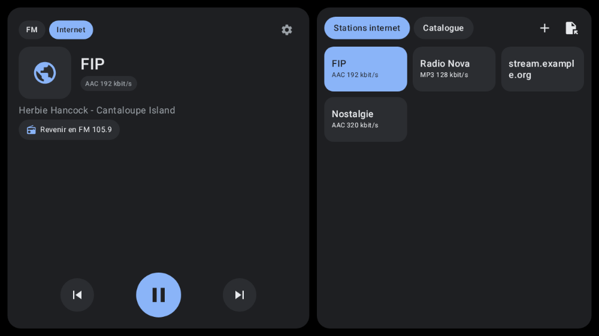<br>Radio internet | 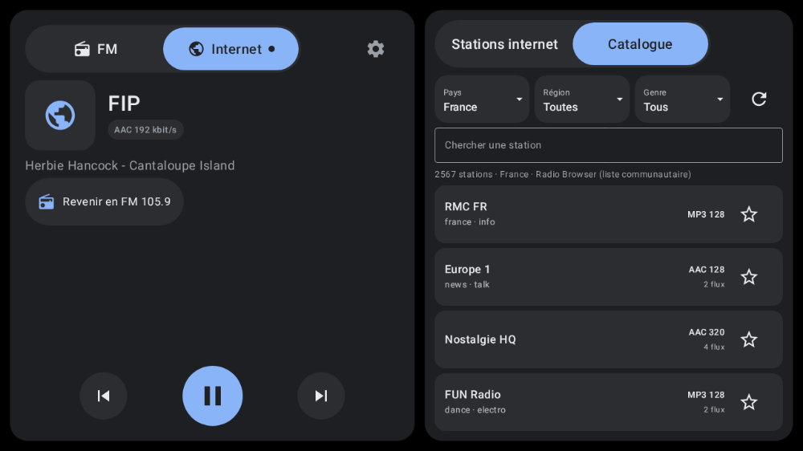<br>Catalogue |
| 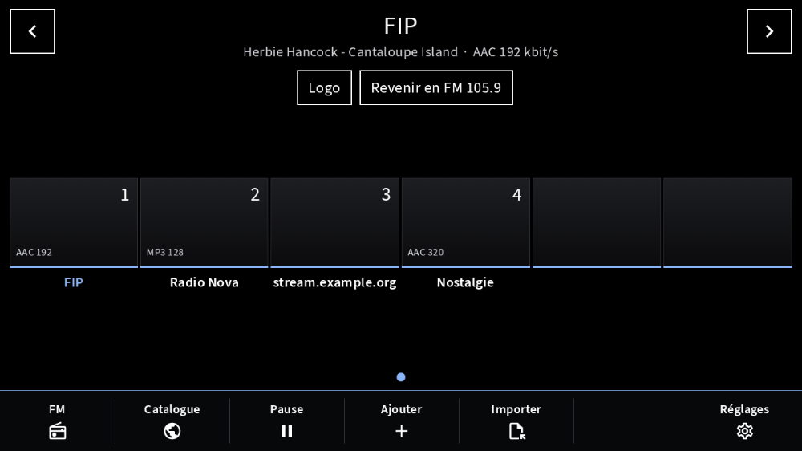<br>Style Modularer Infotainment-Baukasten : internet | 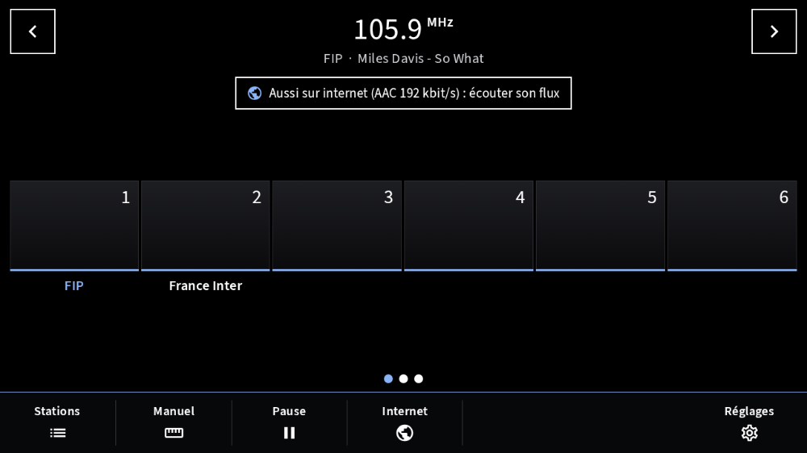<br>Style Modularer Infotainment-Baukasten : proposition du flux |
| 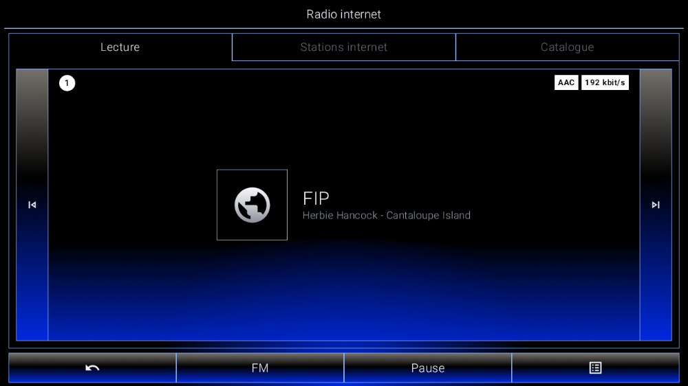<br>Style LHU-Link : internet | 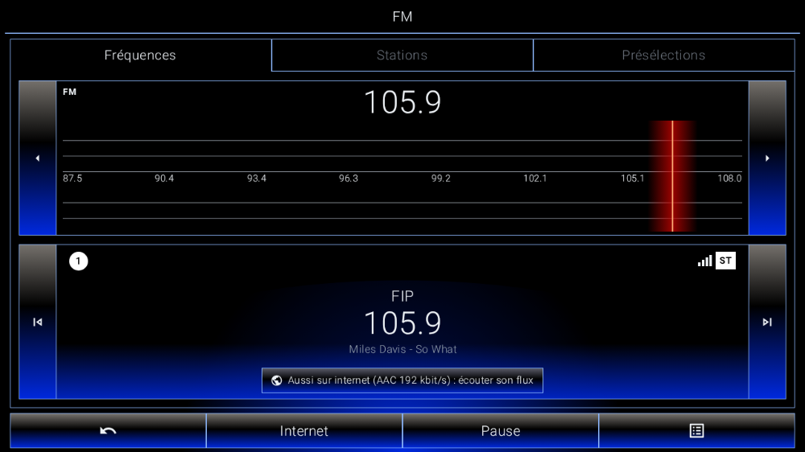<br>Style LHU-Link : proposition du flux |

Captures rendues par Paparazzi (Compose sur la JVM, 1280×720, 160 dpi, en français) avec des données d'exemple et la
liste française de Radio Browser du 02/11/2026 ; pas encore refaites par l'action Screenshots.

- **Lecteur** : [Media3 ExoPlayer](https://developer.android.com/media/media3/exoplayer/supported-formats) (MP3, AAC /
  HE-AAC, Opus, Vorbis, FLAC, flux HLS). Le titre envoyé par le flux (métadonnées ICY des serveurs SHOUTcast / Icecast,
  [`IcyInfo`](https://developer.android.com/reference/androidx/media3/extractor/metadata/icy/IcyInfo)) s'affiche
  comme le RT+ de la FM ; codec et débit réellement reçus sous le nom. Tampon de 15 à 60 s et **reconnexion
  automatique** après une coupure (tunnel, pas de réseau) : 2, 4, 8, 15 s puis toutes les 30 s tant que la station est
  demandée, et **tout de suite quand le réseau revient** (réseau validé par Android). Focus audio géré par le lecteur
  (pause pendant un appel, volume baissé pendant un guidage). Les titres envoyés par le flux vont dans les **Titres
  entendus** (Paramètres), avec le nom de la station.
- **Ajouter à la main** (onglet *Stations internet*) : **+** = adresse du flux, ou d'une liste **M3U / M3U étendu /
  PLS** (le lien « écouter » d'une station), lue à chaque lecture (une station qui change de serveur garde le même lien) ;
  bouton fichier = **import d'un fichier M3U ou PLS** (clé USB, mémoire interne) : chaque station du fichier est
  ajoutée, avec le nom de `#EXTINF` ou `TitleN`. Un `.m3u8` qui est un flux HLS (`#EXT-X-`) est joué comme tel. Appui
  long sur une station : la retirer. Flux `http://` acceptés (beaucoup de radios n'ont pas de https). **Logo** : celui
  du catalogue, ou une image de l'autoradio choisie pour la station (toucher le logo, ou la touche / l'option Logo
  dans les styles de voiture), comme pour la FM ; retour au logo automatique au même endroit.
- **Catalogue** (onglet *Catalogue*) : la liste de [Radio Browser](https://www.radio-browser.info) (base communautaire,
  déjà utilisée pour les logos) du pays des réglages, téléchargée en une fois (environ 4 Mo pour la France) et gardée
  une semaine (bouton Actualiser), utilisable hors ligne ensuite :
  - **choix en grandes tuiles** (pays, région, genre), à la place de la liste, pensé pour un écran de voiture : un
    toucher sur la touche du filtre ouvre une grille, un toucher choisit. Régions : « Toutes », les régions d'au moins
    5 stations (19 pour la France : tout tient sur un écran), « Nationales / sans région », puis « Autres régions »
    (les petites, de A à Z). Genres : les 21 plus utilisés, puis « Autres genres ». **Pays** : celui de l'autoradio
    en premier, puis par nombre de stations, puis « Autres pays » ; ce choix ne change pas la bande FM (réglage à part
    du pays de la FM) ;
  - **par région** : champ « state » de Radio Browser, écritures fusionnées (« Ile de France » = « Île-de-France ») ;
    le pays lui-même, « Europe » et les stations sans région sont rangés dans **Nationales / sans région**. Relevé du
    02/11/2026 : une station française sur cinq seulement a une région (760 sur 3 547) ; les grands réseaux nationaux
    n'en ont pas. La liste étant communautaire, une région manquante se corrige sur radio-browser.info ;
  - **par genre** (étiquettes de Radio Browser, celles d'au moins 3 stations : jazz, rock, news… et réseaux) et par
    **nom** ;
  - **une ligne par station** : ses différents flux (France Inter en a 8 : AAC 192, MP3 128…) sont regroupés et celui
    joué suit le réglage de **qualité** ; un toucher joue, l'étoile enregistre. L'appli signale chaque lecture à Radio
    Browser (`json/url/<id>`, demandé par sa documentation pour classer les stations).
- **Qualité** (Réglages → Radio internet) : **Meilleur son** (FLAC en premier, puis le plus haut débit, AAC / Opus
  comptés 1,5 fois le MP3) ou **Moins de données** (plus petit débit, 48 kbit/s au moins). Repères : 128 kbit/s ≈ 58 Mo
  par heure, 320 kbit/s ≈ 144 Mo, FLAC 300 à 450 Mo. La sortie d'Android vers la puce son de l'UJC201 (BD37534,
  analogique) est en stéréo 48 kHz / 16 bits : au-delà de la qualité CD, rien ne s'entend en plus.
- **Passer de la FM à internet** (Réglages → Radio internet, activé par défaut) : pendant l'écoute FM, quand la station
  (nom RDS, ou indicatif aux États-Unis) existe aussi sur internet **et** qu'internet marche (réseau validé), l'écran FM
  propose « Aussi sur internet (AAC 192 kbit/s) : écouter son flux » ; un toucher bascule, et « Revenir en FM » ramène
  la fréquence. Recherche dans le catalogue gardé, sinon par nom sur Radio Browser (comme les logos). **Seulement sur
  un nom sans doute** : deux stations presque aussi proches du nom RDS tronqué à 8 caractères (« FRANCE I » : France
  Info ou France Inter ?) = rien n'est proposé. Essai sur la liste française (02/11/2026) : 15 noms RDS courants sur 20
  trouvent leur flux (FIP, RTL, Skyrock, Europe 1, Mouv', Nostalgie en AAC 320…) ; les abréviations (« FRINTER »)
  et les noms ambigus (« NRJ ») ne proposent rien.
- **Styles de LibreHU Launcher** :
  - **Modularer Infotainment-Baukasten** : touche **Internet** sur l'écran FM (à la place de la touche de bande de
    l'original) ; écran internet = la station entre ‹ › (station enregistrée précédente / suivante), son titre ou son
    état, touches encadrées Enregistrer / Logo / Revenir en FM, puis les stations enregistrées en **tuiles de 6** (appui
    long : retirer) ; touches du bas FM, Catalogue, lecture / pause, Ajouter, Importer, Réglages ; catalogue en liste
    (touches Région, Genre, Actualiser, recherche ; étoile = enregistrer). Sur l'écran FM, la proposition du flux est
    une touche encadrée sous la fréquence ;
  - **LHU-Link** : touche **Internet** dans la barre du bas de l'écran FM ; écran « Radio internet » à onglets
    **Lecture / Stations internet / Catalogue** dans les cadres de l'original (panneau de la station avec ⏮ ⏭ sur les
    côtés, logo encadré, drapeaux du codec et du débit ; listes sur le trait rouge de sélection) ; barre FM / lecture,
    Options : ajouter, importer, enregistrer, logo, revenir en FM, réglages. Sur l'écran FM, la proposition du flux est
    une petite touche éclairée dans le panneau de la station (et une ligne des Options).
- **Appli téléphone (Bridge)** : page radio : marche / arrêt de la source jouée, choix **FM / Radio internet**, choix
  de la **station internet** enregistrée ; page des réglages : qualité et proposition du flux.
- **Limites** : les annonces trafic (TA) ne se font qu'en FM (la puce FM est éteinte pendant une station internet) ;
  la « HD Radio » américaine (numérique sur la bande FM) demande une puce de démodulation que l'UJC201 n'a pas : seule
  la qualité des flux internet est concernée ici.

## Captures d'écran

| | |
|---|---|
| 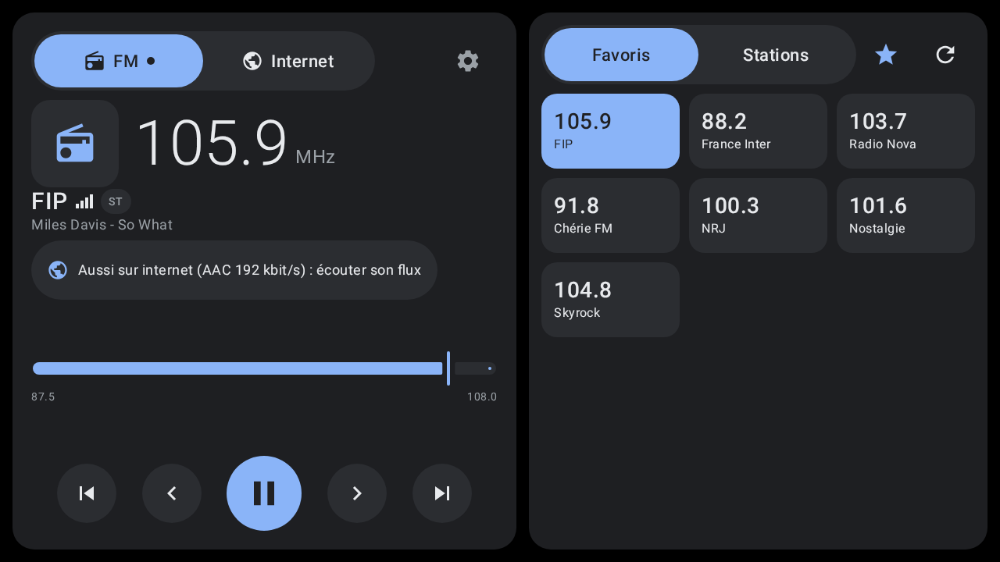<br>Écran principal | 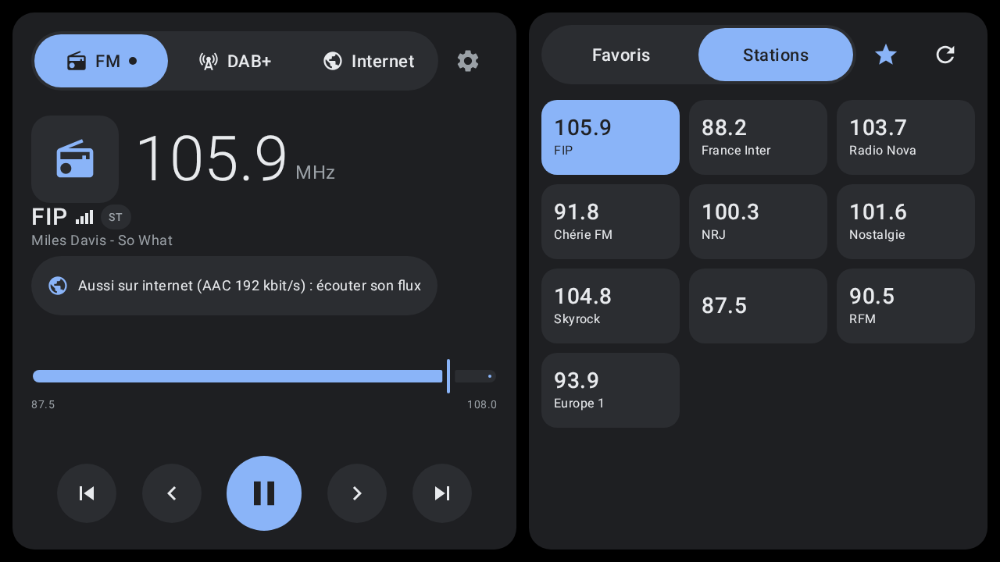<br>Stations |
| 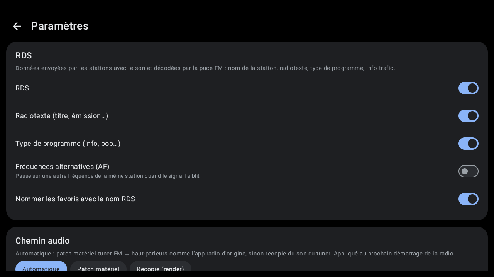<br>Réglages | 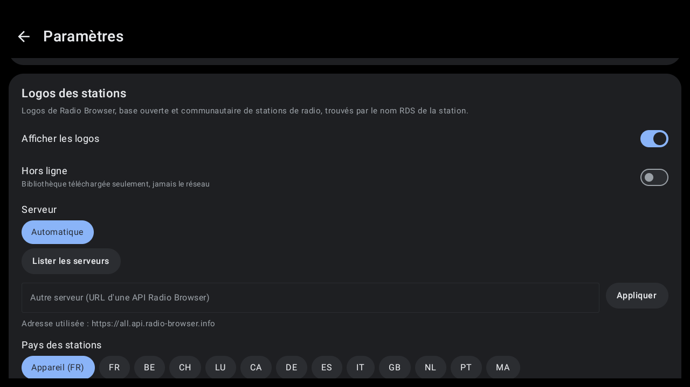<br>Réglages (2) |
| 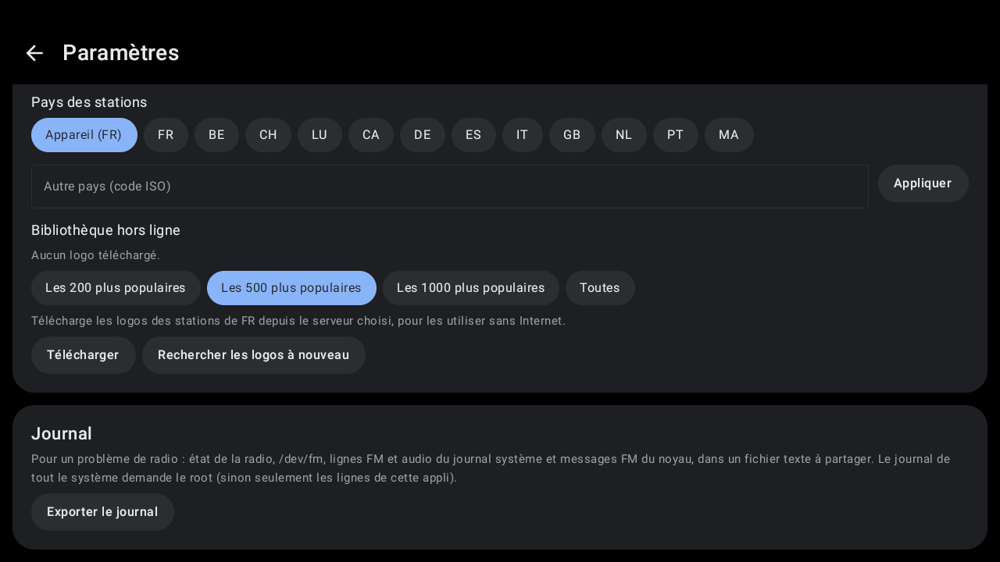<br>Réglages (3) | 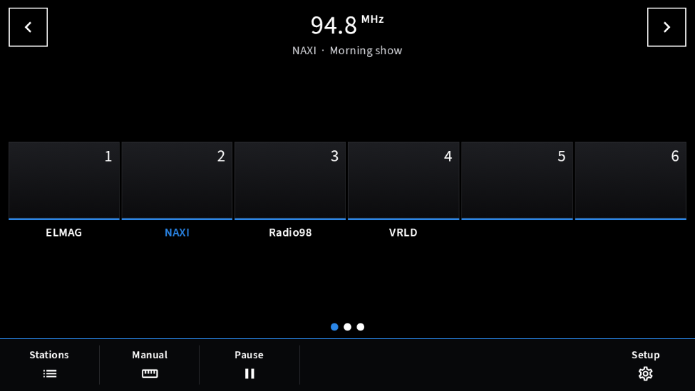<br>Style Modularer Infotainment-Baukasten |
| 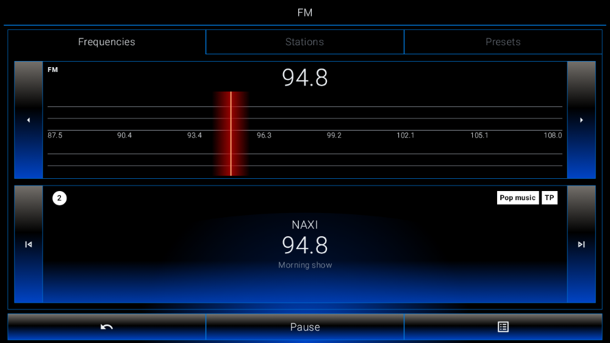<br>Style LHU-Link |   |

Captures sur l'émulateur Android 11 (1280×720, 160 dpi comme l'autoradio), sans autoradio branché : les valeurs du véhicule et de la MCU sont vides. Refaites-les avec l'action **Screenshots** de [LibreHU-OTA-app](https://github.com/LibreHU/LibreHU-OTA-app/tree/main/screenshots). Galerie : [librehu.github.io/screenshots/fm.html](https://librehu.github.io/screenshots/fm.html).

## Branches

Cette branche : **`librehu-service`** (installer LibreHU-service avant l'app radio).


| Branche | Intégration autoradio |
|---|---|
| `main` | aucune (Android générique) |
| `ivi` | Jancar **ivi-services** : `IRadio.open/close` (source radio active, alimentation d'antenne) |
| `librehu-service` | [LibreHU-service](https://github.com/LibreHU/LibreHU-service) : alimentation d'antenne |

## Installation (obligatoirement en app privilégiée)

`/dev/fm` appartient au groupe `media` (permission `ACCESS_BROADCAST_RADIO`), le patch audio exige
`MODIFY_AUDIO_ROUTING` et l'API cachée `AudioManager.createAudioPatch` (liste blanche dans le fichier XML), la
capture `RADIO_TUNER` exige `CAPTURE_AUDIO_OUTPUT` : permissions réservées aux apps privilégiées. Avec root ou en reconstruisant la ROM :

```
adb root && adb remount
adb shell mkdir -p /system/priv-app/LibreHU-FM
adb push LibreHU-FM-librehu-service.apk /system/priv-app/LibreHU-FM/LibreHU-FM.apk
adb push install/privapp-permissions-org.librehu.fm.xml /system/etc/permissions/
adb reboot
```
L'APK vient de la release `latest-<branche>` du dépôt (build *release* signé avec la clé commune des applis LibreHU).
Au premier lancement, accepter la permission micro (`RECORD_AUDIO`, demandée par Android pour toute capture).

Essayé aux États-Unis par Reo Au In (02/11/2026) : région Amériques et RDS américain (RBDS) OK. Le reste (niveau
audio, autres régions) reste à valider sur l'appareil ; la séquence est celle d'AOSP et de l'app Jancar.

### Journal FM
**Réglages → Journal → Exporter le journal** : un fichier texte (`librehu-fm-<date>.log`, enregistré où on veut) avec
l'état de la radio et des réglages, `/dev/fm` (existe, lisible, inscriptible), la bibliothèque native, les lignes FM
et audio du logcat (`LibreHU-FM`, `FMLIB_*`, pilote MediaTek FM / WMT, AudioFlinger / AudioPolicy), les 400
dernières lignes, les messages FM / WMT du noyau (`dmesg`) et les propriétés FM / audio. Avec le root : journal de
tout le système ; sans : Android ne donne à l'appli que ses propres lignes.

### « La puce FM n'a pas démarré (/dev/fm) » avec `FMR_pwr_up error freq: 1000`
Corrigé : installée en appli privilégiée, l'appli charge la `libfmcust.so` de Jancar (`/system/lib64`), qui donne la
bande en pas de 10 kHz (8750 à 10800), alors que la mise sous tension se fait en pas de 100 kHz (1000 = 100 MHz) :
le contrôle de bande refusait toute fréquence avant même d'appeler le pilote. Il compare maintenant dans la même
unité.

### « La puce FM n'a pas démarré (/dev/fm) »
`/dev/fm` s'ouvre mais la mise sous tension (`FM_IOCTL_POWERUP`) est refusée par le pilote. L'appli réessaie une fois
après avoir refermé et rouvert `/dev/fm` (la fonction FM de la puce combo, WMT, peut ne pas être prête). Si l'erreur
reste, le journal du pilote dit pourquoi :
```
adb shell su -c "dmesg | grep -i -E 'fm|wmt'" > fm_dmesg.txt
adb logcat -d -s LibreHU-FM FMLIB_COM FMLIB_CORE FMLIB_JNI FMLIB_ERR > fm_logcat.txt
```

## Root (SuperSU) : demandé une fois pour toutes

Cette appli a besoin du root par SuperSU (installé dans la ROM) ; chaque demande doit être accordée avec « Se
souvenir ». Pour que toutes les fenêtres SuperSU arrivent au même moment, l'assistant de premier démarrage de LibreHU
Launcher (« Autoriser le root pour toutes les applis LibreHU ») interroge chaque appli LibreHU l'une après l'autre :
`RootRequestReceiver`, sur `org.librehu.action.REQUEST_ROOT` envoyé à ce paquet, lance une fois `id` par `su` (SuperSU
affiche alors la demande de cette appli), puis répond `org.librehu.action.ROOT_RESULT` (extras `package`, `granted`)
au paquet indiqué dans `reply_to`. Rien d'autre que `id` n'est lancé ; une seconde demande dans les 20 s est ignorée. Seule une appli signée avec la clé LibreHU peut l'envoyer (permission de signature `org.librehu.permission.ROOT_REQUEST`).

Toutes les commandes root passent par `Su.kt` : `su -c COMMANDE` pour Magisk, KernelSU, KernelSU Next, APatch et
SuperSU, `su 0 sh -c COMMANDE` pour le vieux `su` d'AOSP de certaines ROM Jancar (`/system/xbin/su` :
`su [UID [COMMANDE…]]`, refuse `-c` avec « invalid uid/gid »), reconnu une fois par `su -v` (les autres y répondent
par leur version, sans demande de root). Avec KernelSU / KernelSU Next, autoriser l'appli dans le gestionnaire (liste
Superuser) : le noyau ne détourne `/system/bin/su` que pour les applis autorisées.

## Appli téléphone (LibreHU Bridge)

Réglable depuis le téléphone par l'appli LibreHU Bridge (Android et iPhone), à travers LibreHU-service : la radio (marche, fréquence, stations, recherche, balayage) et tous les réglages (RDS et RT+, bande et région, chemin audio, radio internet, logos).
Fournisseur `<paquet>.bridge` (`bridge/BridgeProvider.kt`), réservé aux applis signées avec la clé LibreHU (permission
`org.librehu.permission.BRIDGE`, vérifiée dans `call()` lui-même) ; format décrit dans
[LibreHU-service, docs/bridge.md](https://github.com/LibreHU/LibreHU-service/blob/main/docs/bridge.md).

## Optimisation (R8)

L'APK publié par la CI (`assembleRelease`) est **optimisé par R8** : code et ressources réduits et optimisés, ce qui
rend Jetpack Compose nettement plus fluide ([Compose performance](https://developer.android.com/develop/ui/compose/performance)),
**sans renommage** (`-dontobfuscate` dans `app/proguard-rules.pro`) : les traces des journaux restent lisibles. Les
règles gardent aussi ce qui n'est appelé que par son nom (méthodes natives, helpers root lancés par `app_process`). Si
une fonction plante avec « class / method not found », regarder `usage.txt` dans l'artefact *R8 reports* de la CI (ce
que R8 a retiré) et ajouter une règle `-keep`.

**Styles Modularer Infotainment-Baukasten et LHU-Link de LibreHU Launcher** : c'est le launcher qui les choisit et les demande à l'appli (il publie `style` = `factory` ou `ambient`, comme pour le style rétro) ; l'appli suit tout de suite : palette noire du style même en mode jour, coins carrés partout, police Source Sans 3 pour Modularer Infotainment-Baukasten (SIL OFL 1.1, `third_party/SourceSans3-LICENSE.md`), lettres fines pour LHU-Link. Rien à régler dans l'appli.

Les **fenêtres** (confirmations, choix, listes) suivent aussi le style : boîte noire à filet blanc (Modularer Infotainment-Baukasten) ou bleu nuit à filet d'accent (LHU-Link). L'écran **Réglages** est encadré comme les autres (touche Retour, titre, sections, interrupteurs et choix du style).

**Son des touches** : chaque toucher (sans glisser ni appui long) fait le petit son choisi dans LibreHU Launcher
(Paramètres → Personnalisation → Son des touches : un son par style parmi 26, ou aucun) ; le launcher le publie
(colonne / extra `click`), un launcher plus ancien donne le son par défaut de son style. Sons de LibreHU (synthétisés),
de **Kenney** ([kenney.nl](https://kenney.nl/assets/interface-sounds), CC0, version WAV de **Hugo Locurcio (Calinou)** :
[Calinou/kenney-interface-sounds](https://github.com/Calinou/kenney-interface-sounds)) et de l'**Android Open Source
Project** (sons tactiles, Apache 2.0) : détail et licences dans `third_party/KEYCLICK-SOUNDS.md`
(`res/raw/click_*.wav`, `ui/KeyClick.kt`).

L'écran radio prend aussi la **mise en page** de ces styles (`ui/RadioStyled.kt`, éléments communs dans `ui/CarKit.kt`) :

- **Modularer Infotainment-Baukasten** : la fréquence entre deux touches encadrées ‹ › (recherche de station ; pas de
  0,1 MHz en mode Manuel), le nom RDS et le radiotexte dessous, des pages de **6 présélections en tuiles numérotées**
  (trait de la couleur d'accent, nom dessous, logo de la station écoutée, points de page ; une tuile vide mémorise la
  station écoutée, un appui long sur la station écoutée la retire), la **liste des stations** (« Actualiser la liste
  des stations » en tête, recherche en cours avec la fréquence) et une **échelle Manuel** (toucher ou glisser).
  Touches du bas : Stations, Manuel, Lecture / Pause, Réglages.
- **LHU-Link** : onglets **Fréquences / Stations / Présélections** ; Fréquences = panneau d'accord (◀ ▶ par 0,1 MHz,
  échelle à lignes fines et aiguille rouge lumineuse, toucher ou glisser) au-dessus du panneau de la station (⏮ ⏭
  recherche, numéro de présélection, type de programme et TP / TA) ; Stations = liste qui tourne, station écoutée au
  milieu sur le trait rouge avec le haut-parleur ; Présélections = liste numérotée. Barre du bas : Retour, Lecture /
  Pause, Options (actualiser la liste, mémoriser / retirer la station, réglages).

Mise en page reprise des styles de LibreHU Launcher, avec les icônes Material de LibreHU : aucun logo, nom, icône,
police ni image d'un constructeur.

**Style rétro et police de LibreHU Launcher** : quand le launcher est en style rétro (les couleurs d'un afficheur
d'autoradio tirées de sa couleur d'accent, couleur RGB comprise), cette appli prend sa palette (jour ou nuit) ; quand
la **police d'afficheur à segments** y est choisie (dans tous les styles), cette appli la prend aussi, en majuscules
sans accents (« LibreHU Seg14 », tirée de DSEG14 © keshikan, SIL Open Font License 1.1, voir
`third_party/DSEG-LICENSE.txt`). Le launcher publie le style, la police et la palette par
`content://org.librehu.launcher.theme/theme` (colonnes `style`, `font`, `background`, `surface`, `surface_high`,
`on_accent`, `text`, `text_dim`) et par la diffusion `org.librehu.action.THEME_CHANGED` (mêmes noms en extras).

**Widgets** : mêmes couleurs rétro et même police. Un widget Android 9 ne peut pas utiliser la police d'une appli
(TextView ne charge pas de police dans le contexte restreint de l'écran d'accueil) : avec la police à segments, chaque
texte est dessiné en image (`SegmentViews` : le TextView lui-même, avec la police à segments, mis en page à la
taille du widget, donc coupé avec « … », aligné et sur ses lignes comme d'habitude) et affiché par une ImageView
`<id>_seg` placée comme lui, ajoutée à côté de
chaque texte des layouts `widget*.xml` par `tools/segment_widgets.py` (à relancer après avoir modifié un layout de
widget). Les fonds rétro sont des couleurs unies (Android 9 ne teinte pas un fond de widget ; la case arrondie du
launcher les découpe).

## Soutenir le projet

LibreHU est développé bénévolement, sur le temps libre, et toutes ses applis restent gratuites. Si le projet vous est
utile, vous pouvez le soutenir par un don sur [Liberapay](https://liberapay.com/DokT/donate) (association française à
but non lucratif, dons récurrents) :

[](https://liberapay.com/DokT/donate)
[](https://liberapay.com/DokT/)
