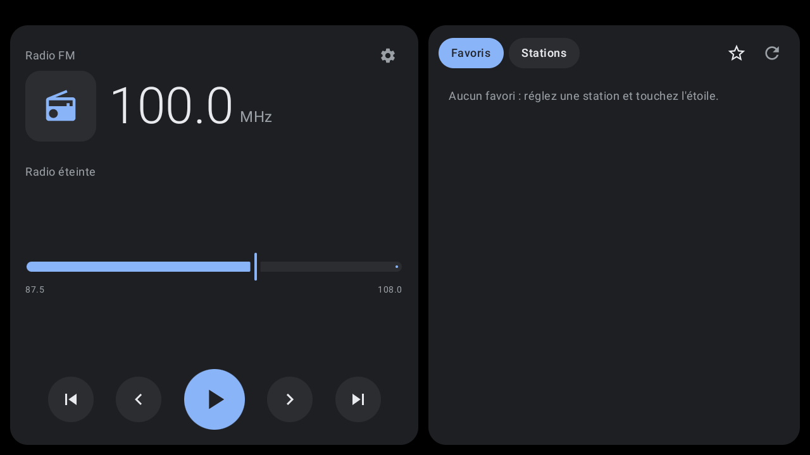
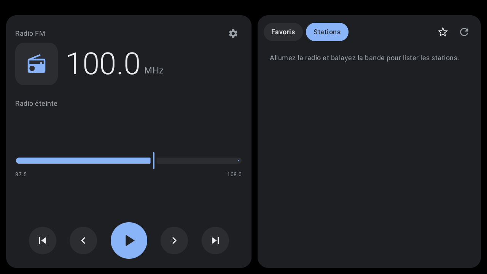

# LibreHU FM

Radio FM pour autoradios Autochips AC8257 (Jancar UJC201) et autres appareils MediaTek, au style des interfaces
voiture (thème sombre, grosses cibles tactiles), avec **widget** pour le lanceur
[LibreHU-Launcher](https://github.com/LibreHU/LibreHU-Launcher-App).

- Puce FM interne MediaTek (combo **MT6631**) pilotée par `/dev/fm`, via le JNI FM d'AOSP (Apache 2.0, voir
  [app/src/main/cpp/fmr/README.md](app/src/main/cpp/fmr/README.md)). Les codes ioctl sont les mêmes que ceux de
  l'app radio Jancar d'origine.
- Son : comme l'app radio Jancar, **patch audio matériel** tuner FM → haut-parleur (le son ne passe pas par l'app,
  une piste muette garde le flux média actif) ; à défaut, source de capture `RADIO_TUNER` recopiée vers un flux
  média (méthode « render » d'AOSP FMRadio).
- AC8257 : structure d'accord et unités du pilote `/dev/fm` de l'AC8257 (détecté par `ro.mediatek.platform`),
  relevées dans la `libfmjni.so` de Jancar.
- **Logo de la station** : recherché par le nom RDS dans [Radio Browser](https://www.radio-browser.info)
  (base ouverte), seulement si le nom correspond, puis gardé en cache par fréquence ; affiché dans l'app, le widget,
  la notification et la carte média du lanceur. Nécessite Internet la première fois. Les noms RDS (8 caractères,
  souvent abrégés) sont rapprochés : « ICIVAUCL » trouve « ici Vaucluse » (ou son ancien nom « France Bleu
  Vaucluse »), « RTV FM » trouve « RTV » ou « Radio RTV ». Une station absente de Radio Browser : **toucher le
  logo** pour choisir une image pour cette fréquence (ou revenir au logo automatique).
- Recherche ▲▼, pas de 0,1 MHz, balayage de la bande, favoris.
- **RDS** décodé par la puce FM : nom de station, radiotexte, type de programme (PTY), TP / TA, fréquences
  alternatives (AF, option), nommage automatique des favoris.
- **Paramètres** (roue dentée) : RDS, chemin audio (automatique / patch matériel / recopie), logos : serveur Radio
  Browser (automatique, miroir de la liste officielle ou URL personnalisée), pays, **bibliothèque hors ligne**
  (téléchargement des logos des stations du pays, les plus populaires ou toutes) et mode hors ligne.
- `MediaSession` : touches au volant, notification, carte « média » du lanceur.
- **Thème clair / sombre** : suit le lanceur [LibreHU Launcher](https://github.com/LibreHU/LibreHU-Launcher-App)
  (y compris le mode automatique selon les feux et la couleur d'accent), sinon le thème sombre d'Android.
- Widget : station, radiotexte, précédente / lecture / suivante, aux couleurs du lanceur (couleur d'accent).
- Son des autres applis préservé : l'app n'envoie jamais `AudioFmPreStop=1` au HAL audio MediaTek (ce paramètre coupe
  le flux média de la sortie principale, donc tout le son d'Android et l'AUX) et le remet à 0 au démarrage et à
  l'arrêt de la radio.

## Captures d'écran

| | |
|---|---|
| <br>Radio | <br>Stations |

Captures sur l'émulateur Android 11 (1280×720, 160 dpi comme l'autoradio), sans autoradio branché : les valeurs du véhicule et de la MCU sont vides. Refaites-les avec l'action **Screenshots** de [LibreHU-OTA-app](https://github.com/LibreHU/LibreHU-OTA-app/tree/main/screenshots).

## Branches

| Branche | Intégration autoradio |
|---|---|
| `main` | aucune (Android générique) |
| `ivi` | Jancar **ivi-services** : `IRadio.open/close` (source radio active, alimentation d'antenne) |
| `librehu-service` | [LibreHU-service](https://github.com/LibreHU/LibreHU-service) : alimentation d'antenne |

## Installation (obligatoirement en app privilégiée)

`/dev/fm` appartient au groupe `media` (permission `ACCESS_BROADCAST_RADIO`), le patch audio exige
`MODIFY_AUDIO_ROUTING` et l'API cachée `AudioManager.createAudioPatch` (liste blanche dans le fichier XML), la
capture `RADIO_TUNER` exige `CAPTURE_AUDIO_OUTPUT` : permissions réservées aux apps privilégiées. Avec root ou en reconstruisant la ROM :

```
adb root && adb remount
adb shell mkdir -p /system/priv-app/LibreHU-FM
adb push LibreHU-FM-librehu-service.apk /system/priv-app/LibreHU-FM/LibreHU-FM.apk
adb push install/privapp-permissions-org.librehu.fm.xml /system/etc/permissions/
adb reboot
```
L'APK vient de la release `latest-<branche>` du dépôt (build *release* signé avec la clé commune des applis LibreHU).
Au premier lancement, accepter la permission micro (`RECORD_AUDIO`, demandée par Android pour toute capture).

Non testé sur l'appareil à ce stade : la séquence est celle d'AOSP et de l'app Jancar, mais le comportement réel
(niveau audio, RDS) reste à valider.

### Journal FM
**Réglages → Journal → Exporter le journal** : un fichier texte (`librehu-fm-<date>.log`, enregistré où on veut) avec
l'état de la radio et des réglages, `/dev/fm` (existe, lisible, inscriptible), la bibliothèque native, les lignes FM
et audio du logcat (`LibreHU-FM`, `FMLIB_*`, pilote MediaTek FM / WMT, AudioFlinger / AudioPolicy), les 400
dernières lignes, les messages FM / WMT du noyau (`dmesg`) et les propriétés FM / audio. Avec le root : journal de
tout le système ; sans : Android ne donne à l'appli que ses propres lignes.

### « La puce FM n'a pas démarré (/dev/fm) » avec `FMR_pwr_up error freq: 1000`
Corrigé : installée en appli privilégiée, l'appli charge la `libfmcust.so` de Jancar (`/system/lib64`), qui donne la
bande en pas de 10 kHz (8750 à 10800), alors que la mise sous tension se fait en pas de 100 kHz (1000 = 100 MHz) :
le contrôle de bande refusait toute fréquence avant même d'appeler le pilote. Il compare maintenant dans la même
unité.

### « La puce FM n'a pas démarré (/dev/fm) »
`/dev/fm` s'ouvre mais la mise sous tension (`FM_IOCTL_POWERUP`) est refusée par le pilote. L'appli réessaie une fois
après avoir refermé et rouvert `/dev/fm` (la fonction FM de la puce combo, WMT, peut ne pas être prête). Si l'erreur
reste, le journal du pilote dit pourquoi :
```
adb shell su -c "dmesg | grep -i -E 'fm|wmt'" > fm_dmesg.txt
adb logcat -d -s LibreHU-FM FMLIB_COM FMLIB_CORE FMLIB_JNI FMLIB_ERR > fm_logcat.txt
```
