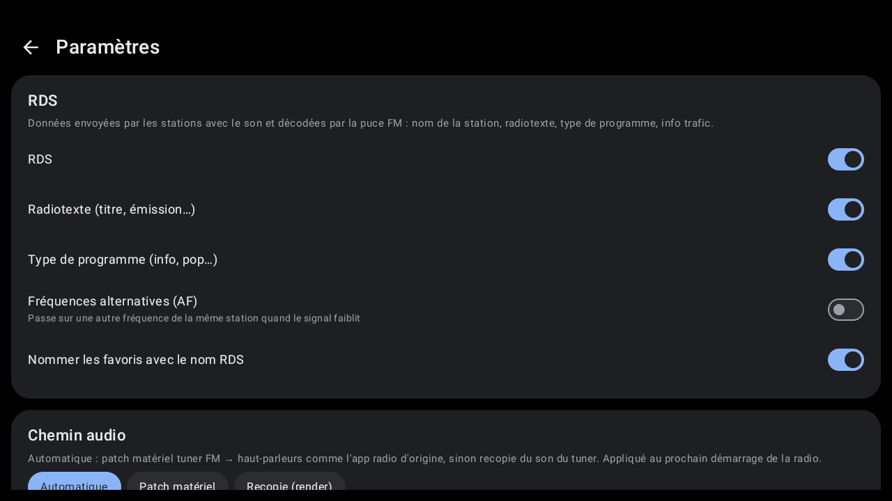
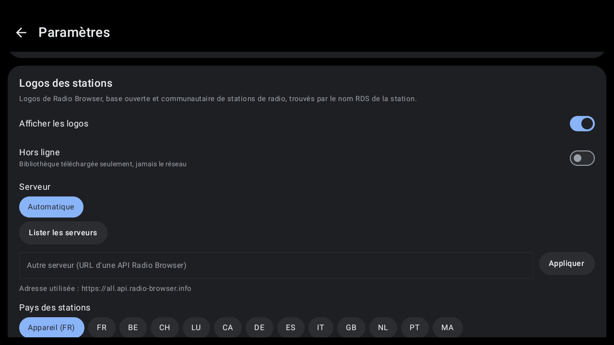
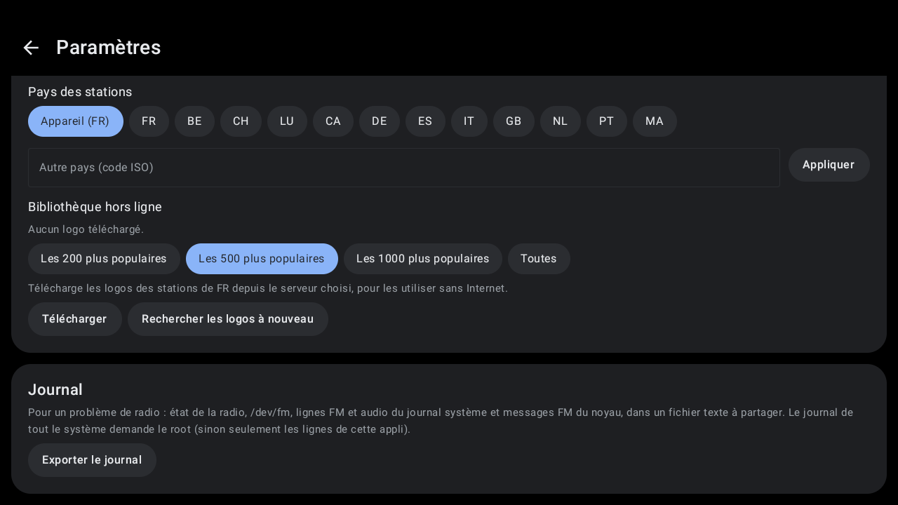
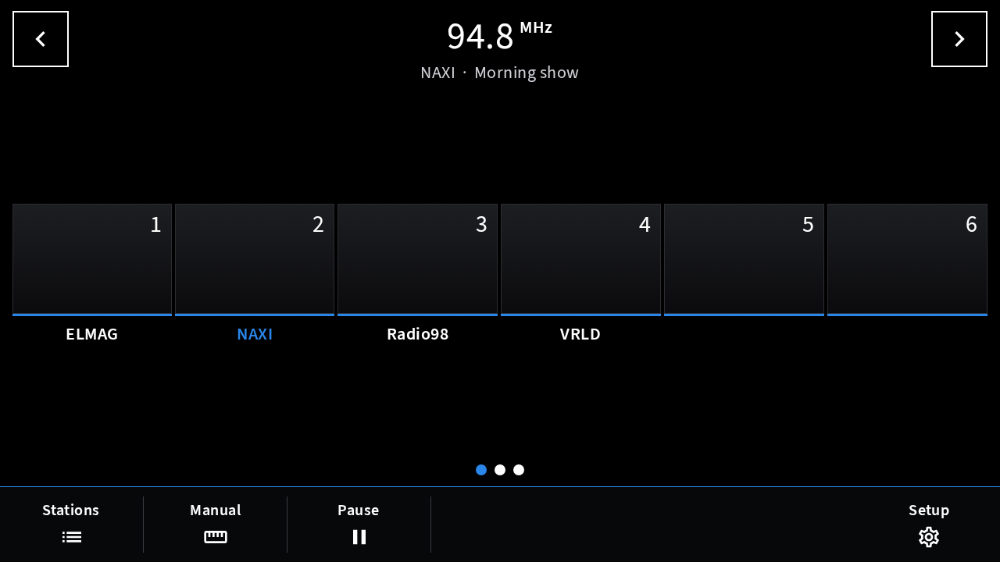
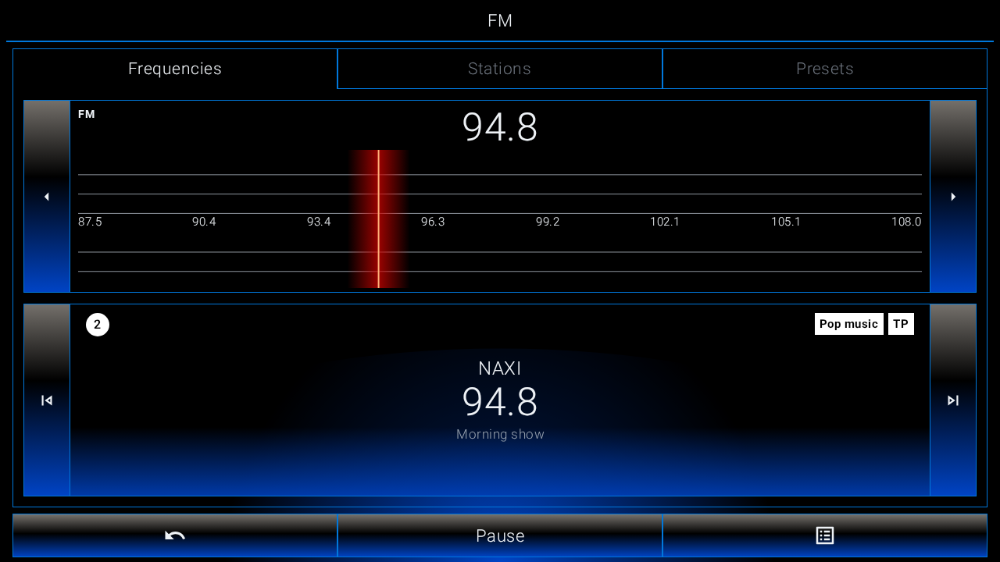

# LibreHU FM

Radio FM pour autoradios Autochips AC8257 (Jancar UJC201) et autres appareils MediaTek, au style des interfaces
voiture (thème sombre, grosses cibles tactiles), avec **widget** pour le lanceur
[LibreHU-Launcher](https://github.com/LibreHU/LibreHU-Launcher-App).

- Puce FM interne MediaTek (combo **MT6631**) pilotée par `/dev/fm`, via le JNI FM d'AOSP (Apache 2.0, voir
  [app/src/main/cpp/fmr/README.md](app/src/main/cpp/fmr/README.md)). Les codes ioctl sont les mêmes que ceux de
  l'app radio Jancar d'origine.
- Son : comme l'app radio Jancar, **patch audio matériel** tuner FM → haut-parleur (le son ne passe pas par l'app,
  une piste muette garde le flux média actif) ; à défaut, source de capture `RADIO_TUNER` recopiée vers un flux
  média (méthode « render » d'AOSP FMRadio). Le pilote MediaTek coupe le son de la puce pendant un accord, une
  recherche ou un balayage : comme `FmService.tuneStation` d'AOSP, l'appli le rétablit après chacun (sinon silence
  jusqu'à pause / lecture).
- AC8257 : structure d'accord et unités du pilote `/dev/fm` de l'AC8257 (détecté par `ro.mediatek.platform`),
  relevées dans la `libfmjni.so` de Jancar.
- **Logo de la station** : recherché par le nom RDS dans [Radio Browser](https://www.radio-browser.info)
  (base ouverte), seulement si le nom correspond, puis gardé en cache par fréquence ; affiché dans l'app, le widget,
  la notification et la carte média du lanceur. Nécessite Internet la première fois. Les noms RDS (8 caractères,
  souvent abrégés) sont rapprochés : « ICIVAUCL » trouve « ici Vaucluse » (ou son ancien nom « France Bleu
  Vaucluse »), « RTV FM » trouve « RTV » ou « Radio RTV ». Une station absente de Radio Browser : **toucher le
  logo** pour choisir une image pour cette fréquence (ou revenir au logo automatique).
- Recherche ▲▼, pas de 0,1 MHz, balayage de la bande, favoris.
- **RDS** décodé par la puce FM : nom de station, radiotexte, type de programme (PTY), TP / TA, fréquences
  alternatives (AF, option), nommage automatique des favoris.
- **Paramètres** (roue dentée) : RDS, chemin audio (automatique / patch matériel / recopie), logos : serveur Radio
  Browser (automatique, miroir de la liste officielle ou URL personnalisée), pays, **bibliothèque hors ligne**
  (téléchargement des logos des stations du pays, les plus populaires ou toutes) et mode hors ligne.
- `MediaSession` : touches au volant, notification, carte « média » du lanceur.
- **Thème clair / sombre** : suit le lanceur [LibreHU Launcher](https://github.com/LibreHU/LibreHU-Launcher-App)
  (y compris le mode automatique selon les feux et la couleur d'accent), sinon le thème sombre d'Android.
- Widget : station, radiotexte, précédente / lecture / suivante, aux couleurs du lanceur (couleur d'accent).
- Son des autres applis préservé : l'app n'envoie jamais `AudioFmPreStop=1` au HAL audio MediaTek (ce paramètre coupe
  le flux média de la sortie principale, donc tout le son d'Android et l'AUX) et le remet à 0 au démarrage et à
  l'arrêt de la radio.

## Captures d'écran

| | |
|---|---|
| <br>Écran principal | <br>Stations |
| <br>Réglages | <br>Réglages (2) |
| <br>Réglages (3) | <br>Style Modularer Infotainment-Baukasten |
| <br>Style LHU-Link |   |

Captures sur l'émulateur Android 11 (1280×720, 160 dpi comme l'autoradio), sans autoradio branché : les valeurs du véhicule et de la MCU sont vides. Refaites-les avec l'action **Screenshots** de [LibreHU-OTA-app](https://github.com/LibreHU/LibreHU-OTA-app/tree/main/screenshots). Galerie : [librehu.github.io/screenshots/fm.html](https://librehu.github.io/screenshots/fm.html).

## Branches

| Branche | Intégration autoradio |
|---|---|
| `main` | aucune (Android générique) |
| `ivi` | Jancar **ivi-services** : `IRadio.open/close` (source radio active, alimentation d'antenne) |
| `librehu-service` | [LibreHU-service](https://github.com/LibreHU/LibreHU-service) : alimentation d'antenne |

## Installation (obligatoirement en app privilégiée)

`/dev/fm` appartient au groupe `media` (permission `ACCESS_BROADCAST_RADIO`), le patch audio exige
`MODIFY_AUDIO_ROUTING` et l'API cachée `AudioManager.createAudioPatch` (liste blanche dans le fichier XML), la
capture `RADIO_TUNER` exige `CAPTURE_AUDIO_OUTPUT` : permissions réservées aux apps privilégiées. Avec root ou en reconstruisant la ROM :

```
adb root && adb remount
adb shell mkdir -p /system/priv-app/LibreHU-FM
adb push LibreHU-FM-librehu-service.apk /system/priv-app/LibreHU-FM/LibreHU-FM.apk
adb push install/privapp-permissions-org.librehu.fm.xml /system/etc/permissions/
adb reboot
```
L'APK vient de la release `latest-<branche>` du dépôt (build *release* signé avec la clé commune des applis LibreHU).
Au premier lancement, accepter la permission micro (`RECORD_AUDIO`, demandée par Android pour toute capture).

Non testé sur l'appareil à ce stade : la séquence est celle d'AOSP et de l'app Jancar, mais le comportement réel
(niveau audio, RDS) reste à valider.

### Journal FM
**Réglages → Journal → Exporter le journal** : un fichier texte (`librehu-fm-<date>.log`, enregistré où on veut) avec
l'état de la radio et des réglages, `/dev/fm` (existe, lisible, inscriptible), la bibliothèque native, les lignes FM
et audio du logcat (`LibreHU-FM`, `FMLIB_*`, pilote MediaTek FM / WMT, AudioFlinger / AudioPolicy), les 400
dernières lignes, les messages FM / WMT du noyau (`dmesg`) et les propriétés FM / audio. Avec le root : journal de
tout le système ; sans : Android ne donne à l'appli que ses propres lignes.

### « La puce FM n'a pas démarré (/dev/fm) » avec `FMR_pwr_up error freq: 1000`
Corrigé : installée en appli privilégiée, l'appli charge la `libfmcust.so` de Jancar (`/system/lib64`), qui donne la
bande en pas de 10 kHz (8750 à 10800), alors que la mise sous tension se fait en pas de 100 kHz (1000 = 100 MHz) :
le contrôle de bande refusait toute fréquence avant même d'appeler le pilote. Il compare maintenant dans la même
unité.

### « La puce FM n'a pas démarré (/dev/fm) »
`/dev/fm` s'ouvre mais la mise sous tension (`FM_IOCTL_POWERUP`) est refusée par le pilote. L'appli réessaie une fois
après avoir refermé et rouvert `/dev/fm` (la fonction FM de la puce combo, WMT, peut ne pas être prête). Si l'erreur
reste, le journal du pilote dit pourquoi :
```
adb shell su -c "dmesg | grep -i -E 'fm|wmt'" > fm_dmesg.txt
adb logcat -d -s LibreHU-FM FMLIB_COM FMLIB_CORE FMLIB_JNI FMLIB_ERR > fm_logcat.txt
```

## Root (SuperSU) : demandé une fois pour toutes

Cette appli a besoin du root par SuperSU (installé dans la ROM) ; chaque demande doit être accordée avec « Se
souvenir ». Pour que toutes les fenêtres SuperSU arrivent au même moment, l'assistant de premier démarrage de LibreHU
Launcher (« Autoriser le root pour toutes les applis LibreHU ») interroge chaque appli LibreHU l'une après l'autre :
`RootRequestReceiver`, sur `org.librehu.action.REQUEST_ROOT` envoyé à ce paquet, lance une fois `su -c id` (SuperSU
affiche alors la demande de cette appli), puis répond `org.librehu.action.ROOT_RESULT` (extras `package`, `granted`)
au paquet indiqué dans `reply_to`. Rien d'autre que `id` n'est lancé ; une seconde demande dans les 20 s est ignorée. Seule une appli signée avec la clé LibreHU peut l'envoyer (permission de signature `org.librehu.permission.ROOT_REQUEST`).

## Appli téléphone (LibreHU Bridge)

Réglable depuis le téléphone par l'appli LibreHU Bridge (Android et iPhone), à travers LibreHU-service : la radio (marche, fréquence, stations, recherche, balayage) et tous les réglages (RDS, chemin audio, logos).
Fournisseur `<paquet>.bridge` (`bridge/BridgeProvider.kt`), réservé aux applis signées avec la clé LibreHU (permission
`org.librehu.permission.BRIDGE`, vérifiée dans `call()` lui-même) ; format décrit dans
[LibreHU-service, docs/bridge.md](https://github.com/LibreHU/LibreHU-service/blob/main/docs/bridge.md).

## Optimisation (R8)

L'APK publié par la CI (`assembleRelease`) est **optimisé par R8** : code et ressources réduits et optimisés, ce qui
rend Jetpack Compose nettement plus fluide ([Compose performance](https://developer.android.com/develop/ui/compose/performance)),
**sans renommage** (`-dontobfuscate` dans `app/proguard-rules.pro`) : les traces des journaux restent lisibles. Les
règles gardent aussi ce qui n'est appelé que par son nom (méthodes natives, helpers root lancés par `app_process`). Si
une fonction plante avec « class / method not found », regarder `usage.txt` dans l'artefact *R8 reports* de la CI (ce
que R8 a retiré) et ajouter une règle `-keep`.

**Styles Modularer Infotainment-Baukasten et LHU-Link de LibreHU Launcher** : c'est le launcher qui les choisit et les demande à l'appli (il publie `style` = `factory` ou `ambient`, comme pour le style rétro) ; l'appli suit tout de suite : palette noire du style même en mode jour, coins carrés partout, police Source Sans 3 pour Modularer Infotainment-Baukasten (SIL OFL 1.1, `third_party/SourceSans3-LICENSE.md`), lettres fines pour LHU-Link. Rien à régler dans l'appli.

**Son des touches** : chaque toucher (sans glisser ni appui long) fait un petit son qui suit le style que LibreHU
Launcher demande à l'appli : tic doux (moderne), bip d'autoradio (rétro), « toc » amorti (Modularer
Infotainment-Baukasten), bip électronique montant (LHU-Link). Sons propres à LibreHU, synthétisés (`res/raw/click_*.wav`,
`ui/KeyClick.kt`) ; coupé quand les « Sons des touches » d'Android sont désactivés (Paramètres → Son).

L'écran radio prend aussi la **mise en page** de ces styles (`ui/RadioStyled.kt`, éléments communs dans `ui/CarKit.kt`) :

- **Modularer Infotainment-Baukasten** : la fréquence entre deux touches encadrées ‹ › (recherche de station ; pas de
  0,1 MHz en mode Manuel), le nom RDS et le radiotexte dessous, des pages de **6 présélections en tuiles numérotées**
  (trait de la couleur d'accent, nom dessous, logo de la station écoutée, points de page ; une tuile vide mémorise la
  station écoutée, un appui long sur la station écoutée la retire), la **liste des stations** (« Actualiser la liste
  des stations » en tête, recherche en cours avec la fréquence) et une **échelle Manuel** (toucher ou glisser).
  Touches du bas : Stations, Manuel, Lecture / Pause, Réglages.
- **LHU-Link** : onglets **Fréquences / Stations / Présélections** ; Fréquences = panneau d'accord (◀ ▶ par 0,1 MHz,
  échelle à lignes fines et aiguille rouge lumineuse, toucher ou glisser) au-dessus du panneau de la station (⏮ ⏭
  recherche, numéro de présélection, type de programme et TP / TA) ; Stations = liste qui tourne, station écoutée au
  milieu sur le trait rouge avec le haut-parleur ; Présélections = liste numérotée. Barre du bas : Retour, Lecture /
  Pause, Options (actualiser la liste, mémoriser / retirer la station, réglages).

Mise en page reprise des styles de LibreHU Launcher, avec les icônes Material de LibreHU : aucun logo, nom, icône,
police ni image d'un constructeur.

**Style rétro et police de LibreHU Launcher** : quand le launcher est en style rétro (les couleurs d'un afficheur
d'autoradio tirées de sa couleur d'accent, couleur RGB comprise), cette appli prend sa palette (jour ou nuit) ; quand
la **police d'afficheur à segments** y est choisie (dans tous les styles), cette appli la prend aussi, en majuscules
sans accents (« LibreHU Seg14 », tirée de DSEG14 © keshikan, SIL Open Font License 1.1, voir
`third_party/DSEG-LICENSE.txt`). Le launcher publie le style, la police et la palette par
`content://org.librehu.launcher.theme/theme` (colonnes `style`, `font`, `background`, `surface`, `surface_high`,
`on_accent`, `text`, `text_dim`) et par la diffusion `org.librehu.action.THEME_CHANGED` (mêmes noms en extras).

**Widgets** : mêmes couleurs rétro et même police. Un widget Android 9 ne peut pas utiliser la police d'une appli
(TextView ne charge pas de police dans le contexte restreint de l'écran d'accueil) : avec la police à segments, chaque
texte est dessiné en image (`SegmentViews` : le TextView lui-même, avec la police à segments, mis en page à la
taille du widget, donc coupé avec « … », aligné et sur ses lignes comme d'habitude) et affiché par une ImageView
`<id>_seg` placée comme lui, ajoutée à côté de
chaque texte des layouts `widget*.xml` par `tools/segment_widgets.py` (à relancer après avoir modifié un layout de
widget). Les fonds rétro sont des couleurs unies (Android 9 ne teinte pas un fond de widget ; la case arrondie du
launcher les découpe).

## Soutenir le projet

LibreHU est développé bénévolement, sur le temps libre, et toutes ses applis restent gratuites. Si le projet vous est
utile, vous pouvez le soutenir par un don sur [Liberapay](https://liberapay.com/DokT/donate) (association française à
but non lucratif, dons récurrents) :

[](https://liberapay.com/DokT/donate)
[](https://liberapay.com/DokT/)
